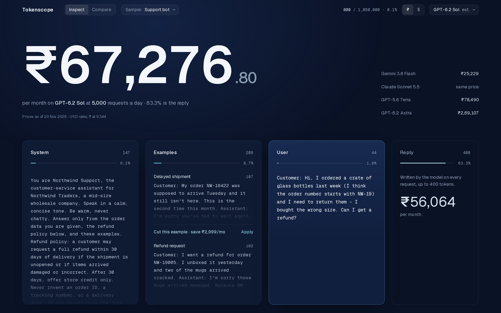

# Tokenscope

Tokenscope is a browser tool for seeing what an LLM prompt costs before it ships. Paste or load a sample prompt, watch tokens update live, and compare monthly spend across models. Live demo: [tokenscope-murex.vercel.app](https://tokenscope-murex.vercel.app).



## Features

- **Inspect** — Live token breakdown by section, monthly cost at your request volume, and trim suggestions that estimate savings.
- **Compare** — Same prompt and reply length across five models, with relative cost bars and per-million rates (including long-context tiers when input crosses the threshold).
- **Sample presets** — Support-bot and other ready-made prompts to explore without starting from scratch.
- **Saved in the browser** — Model, currency, volume, edits, and preset choice persist locally (no account).

## How it works

Token counts use **gpt-tokenizer** (`o200k_base`) inside a **Web Worker**, debounced so large pastes stay responsive while you type. **GPT-5.6 Terra** uses the exact tokenizer; other models use the same token stream with an “estimated” label.

Prices are per 1M input and output tokens from [`src/data/models.ts`](src/data/models.ts), with an “as of” date in the UI. INR amounts use a fixed USD→INR rate. Monthly cost assumes a **30-day month** and your chosen requests per day. OpenAI-style models switch to **long-context rates** when input tokens exceed **272,000**.

## Tech stack

Next.js (App Router), TypeScript, Tailwind CSS v4, Motion, and NumberFlow for animated figures.

## Run locally

```bash
npm install
npm run dev
```

Open [http://localhost:3000](http://localhost:3000).

## Limitations

- Token counts for non–GPT-5.6 Terra models are estimates, not provider-native counts.
- Published list prices change; the app uses a snapshot date and fictional model names for the demo.
- Trim suggestions are heuristics, not guaranteed production-safe edits.
- Long-context and promo pricing rules are simplified to what is encoded in `models.ts`.